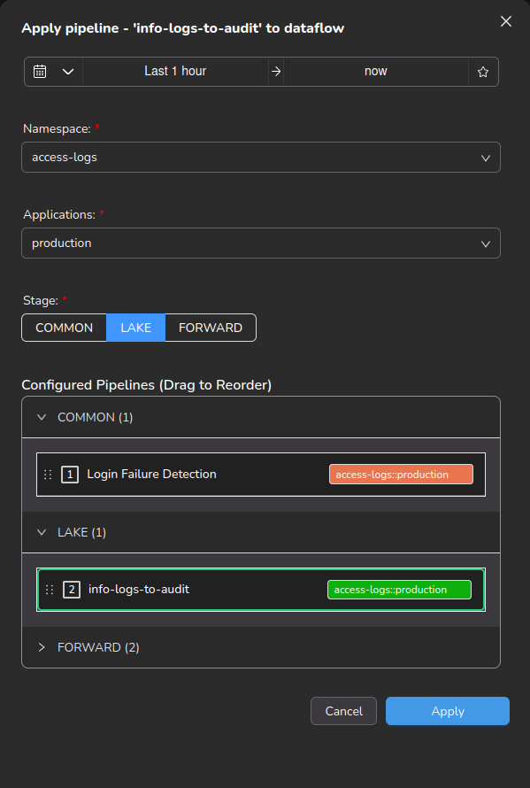
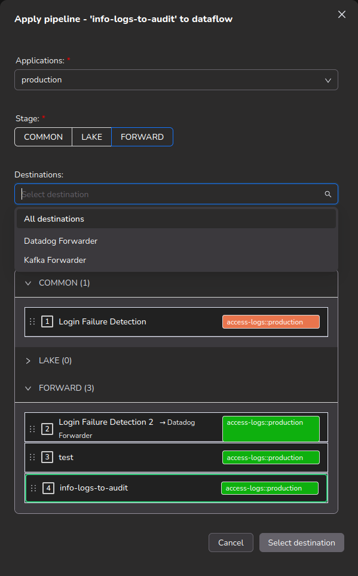

# Configuring Pipelines

The pipeline is a series of processes through which telemetry data flows systematically. A pipeline can be understood as a grouping of rules that perform certain actions. For example, an extract pipeline can have rules that extract or normalize the data. Similarly, a filter pipeline can have rules that drop logs/fields and redact values from the incoming message. Pipelines can be arranged in a specific order to achieve efficient operation on the incoming data.

## Creating a Pipeline

1. Select **Explore** → **Pipelines**.
2. Select **Actions** → **Create Pipeline**.

<figure><figcaption>
Navigating to Pipeline Page
</figcaption></figure>

<figure><figcaption>
Actions button to create Pipeline
</figcaption></figure>

The builder has two panels: **Pipeline Preview** and **Pipeline Configuration**.

<figure><figcaption></figcaption></figure>

Select **EXISTING RULES** to attach saved rules inin **Configure Rules for - \<pipeline>**.

Each rule opens in **Pipeline Configuration**. Complete its shared fields, condition, and rule-specific settings. See [rules](../rules/ "mention") for shared fields and conditions.

<figure><figcaption>
A new drop rule was added
</figcaption></figure>

The rule list shows **Rule Name**, **Rule Type**, **Savings**, **Enabled**, and **Actions**. Drag a rule to reorder execution. Use **Enabled** to switch a rule on or off.

Use **Expand rule** to open one rule at a time. Select **Delete rule** to remove a rule. Confirm **Are you sure you want to remove the rule?**. The deletion takes effect when you save.

Opening a pipeline from **Pipelines** uses a full page. Opening it from the topology graph uses **Configure Pipeline** as a modal. Both views have **Close** and **Save** buttons.

Validation runs when you select **Save**. A banner lists all issues. For each missing required rule field, it displays: `&lt;Field(s)&gt; is a required field and cannot be empty in &lt;rule name&gt; rule.` A missing pipeline name displays: `Pipeline name is a required field and cannot be empty.`

<figure><figcaption>
Created pipeline displayed in the pipeline list
</figcaption></figure>

### Editing a Pipeline

To edit a pipeline, open **Explore** → **Pipelines**. Select the ellipsis beside the pipeline, then select **Configure Pipeline**. It opens as a full page from **Pipelines**.

<figure><figcaption></figcaption></figure>

## Pipeline Preview

Pipeline Preview updates automatically after every pipeline or rule change. It displays the selected logs and changes in the `Diff` view.

#### Use Sample Logs:

Sample Logs allows you to provide custom logs to preview:

<figure><figcaption>
The dropdown helps select the sample logs for preview
</figcaption></figure>

#### Use Data Flows:

Using Dataflows, you can select data that was previously ingested into the platform and run a preview.\
**Note:** If the data from the selected namespace and application has already passed through the current pipeline, the preview may not fully reflect the intended changes.

<figure><figcaption></figcaption></figure>

#### Use GenAI:

Using the GenAi option, you can interact with an AI Agent to curate the right set of logs for the pipeline preview. 

<figure><figcaption></figcaption></figure>

#### Use Captured Data:

With Captured Data, lookup files that contain logs can be used for running a pipeline preview.

<figure><figcaption></figcaption></figure>

#### Live Tail

With Live tail, use the raw logs that are getting ingested in real time to run the pipeline preview.

<figure><figcaption></figcaption></figure>

#### View Preview Changes:

To view the preview changes, click on the `Diff` tab in the Pipeline Preview Section:

<figure><figcaption></figcaption></figure>

After configuring the pipeline and its rules and testing them, click on the Save button in the bottom right section of the page.

### Apply Pipeline

Use **Apply Pipeline** to run the pipeline on a dataflow (a namespace and application). Open it from the pipeline list (ellipsis → **Apply Pipeline**) or from the pipeline builder.

<figure><figcaption>
Apply Pipeline to associate the Namespace and Application to it
</figcaption></figure>

1. Select the time range, then the **Namespace** and **Application**.
2. Select the **Stage** at which the pipeline runs for that dataflow (see below).
3. At the **FORWARD** stage, select the **Destinations** the pipeline runs for.
4. Under **Configured Pipelines**, check the execution order. The pipeline being applied is added at the bottom of its stage, outlined in green. Drag to reorder within a stage.
5. Click **Apply**.

<figure><figcaption></figcaption></figure>

#### Stage

A pipeline is applied to a dataflow at one of three stages. The stage decides which copy of the data the pipeline shapes.

| Stage                | Runs on                                                    | Effect                                                                             |
| -------------------- | ---------------------------------------------------------- | ---------------------------------------------------------------------------------- |
| **COMMON** (default) | Incoming data at ingest, before it is stored or forwarded. | Processed logs flow to both InstaStore and every configured destination.           |
| **LAKE**             | Only the copy written to InstaStore.                       | Destinations receive logs directly, without passing through this pipeline.         |
| **FORWARD**          | Only the copy sent to forwarders.                          | The stored copy is unchanged. You choose which destinations the pipeline runs for. |

COMMON pipelines always run before LAKE and FORWARD pipelines on the same dataflow.

<figure><figcaption></figcaption></figure>

<figure><figcaption></figcaption></figure>

**FORWARD rules only work at the FORWARD stage.** A pipeline that contains a FORWARD rule cannot be applied at COMMON or LAKE. If you select either, the modal shows:

> The pipeline **\<pipeline>** contains FORWARD rules that only take effect at the FORWARD stage. This pipeline cannot be applied at the \<stage> stage. Select the FORWARD stage to apply this pipeline.

<figure><figcaption></figcaption></figure>

**Apply** stays disabled until you select FORWARD. The same check is enforced by the server, so applying through the API, CLI, or Venn is rejected with:

`a pipeline with FORWARD rules can only be applied at the FORWARD stage, not <stage>: FORWARD rules run only on the copy handed to the forwarders and would have no effect`

Adding a FORWARD rule to a pipeline that is already applied at COMMON or LAKE is rejected on save for the same reason; the error names the dataflow.

**Changing the stage of an applied pipeline.** If the pipeline is already applied to the selected dataflow at a different stage, the modal warns:

> '\<pipeline>' is currently applied to \<namespace::application> at \<stage> stage. Applying will move it to \<stage> stage.

Moving a pipeline away from FORWARD clears its destination selection. The warning says where logs go after the move: to LAKE, destinations receive logs directly without this pipeline; to COMMON, processed logs flow to both InstaStore and all configured destinations.

#### Destinations (FORWARD stage only)

At the FORWARD stage the **Destinations** list shows **All destinations** plus every forwarder mapped to the selected dataflow.

* Pick one or more destinations to run the pipeline only on the copy sent to each of them.
* Pick **All destinations** to run it once on the shared copy before the fan-out.
* InstaStore always receives the full stream.

<figure><figcaption></figcaption></figure>

A selection is required: the button reads **Select destination** until you pick one. If a destination is not mapped to the selected dataflow, the modal warns that the pipeline will not run for it there.

If the pipeline is already applied at FORWARD with different destinations, the modal warns:

> '\<pipeline>' currently runs on \<namespace::application> for \<destinations>. Applying will change that to \<destinations>.

**Removing a pipeline from a dataflow.** Clear all destinations on a pipeline that is already applied at FORWARD. The button changes to **Remove from Dataflow**. Confirm **Remove pipeline from dataflow**: the pipeline no longer runs at any stage on that dataflow.

#### Configured Pipelines

**Configured Pipelines (Drag to Reorder)** lists every pipeline on the selected dataflow, grouped into **COMMON**, **LAKE**, and **FORWARD** panels with a count per stage. The panel for the selected stage is open; expand the others to view them. Drag to reorder within a stage; execution follows this order after you apply. A pipeline applied at FORWARD with specific destinations shows them beside its name.

<figure><figcaption></figcaption></figure>

### Pipeline View:

All the Dataflows linked are displayed under the Pipeline and can be accessed using the Arrow icon.

<figure><figcaption>
All the linked Dataflow are displayed under the Pipeline. Along with the stats.
</figcaption></figure>

The Stats displays the Events Ingested, Events Processed and Saved Bytes:

* Green Indicates the total `Events Ingested`.
* Orange Indicates the `Events Processed`.
* Red Indicates the `Saved Bytes`.

Pipelines stats is the total amount of Events and Saved Bytes and the data for each of the associated Dataflow is displayed against the individual Dataflows.
