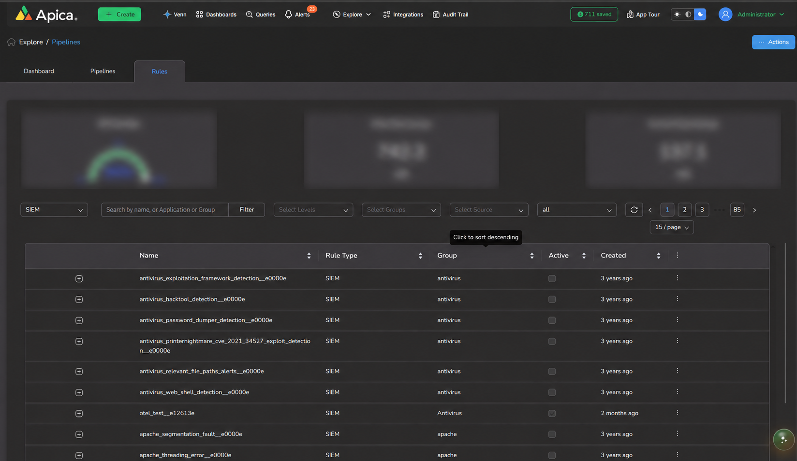

# SIEM

SIEM rules are Log2Metrics rules that help identify and monitor interesting security events in real time. They allow you to convert matching log events into real-time metrics, which can then be used to visualize data, analyze event distributions, create custom indexes, and configure alerts.

SIEM rules are useful for detecting and tracking important events in your logs, such as user login failures, load balancer or ingress status codes, and other security-related activities.

Apica Ascent provides hundreds of built-in SIEM rules that can be accessed from **Explore → Pipeline → Rules**.

<figure><figcaption></figcaption></figure>

### Create a SIEM Rule

Follow these steps to create a SIEM or TAG rule in your pipeline:

#### 2. Add a New SIEM or TAG Rule

Open **Configure Pipeline**, click **Add Rule** under **Rules**, then select **SIEM** or **TAG**. Complete the shared fields and condition in [.](./ "mention").

<figure><figcaption></figcaption></figure>

The rule form will appears in **Pipeline Configuration**.

<figure><figcaption></figcaption></figure>

#### Step-by-Step Rule Configuration

#### 3. Fill in Rule Details

Complete the shared **Details** fields and condition in [.](./ "mention"). SIEM and TAG rules require **Level**.

Sample SIEM rule dashboard

**B. Metric Labels Tab**

This tab allows you to tag logs with structured labels for visualisation, analysis, and metric generation.

*   **Labels:**

    Choose fields (e.g., event type, username, status code) to label logs under the `_event` structure. These labelled events can later be used to generate metrics or reports.
*   **Default Label for Visualisation:**

    Select the main label field to group results in visualisations and PromQL queries (e.g., group by `status_code`, `username`, etc.).

**C. Dashboard tab**

This section is for visualising rule outputs via dashboards.

*   **Select dashboard for visualisation:**

    Choose or create a dashboard to show data from this rule (e.g., _404 Login Attempts_).
*   **Select Values below to plot:**

    Choose which field(s) from the logs you want to visualise (status\_code, port).
* **Plot Types:**
  * **Occurrences:** View average occurrences over time.
  * **Distributions:** View percentile metrics (50th, 90th, 99th) and average duration over the last 5 minutes.

**D. Alerts tab**

This tab allows you to configure alerts for your SIEM rule based on the metrics or log queries you've defined. To enable alerting, switch **"Enable Alert"** to active. Then, specify the **threshold value** and **comparison operator** (e.g., `> 5`) to determine when the alert should trigger based on the rule’s output.

Next, choose your **alert destination channel** (such as **email**, **Slack**, or **webhook**) to receive notifications. This option becomes available once the alert is activated.

You can also fine-tune alert behaviour by configuring parameters such as:

* **Rearm**: Controls how frequently the alert can be re-triggered after it has already fired.
* **Refresh Interval**: Defines how often the query is evaluated to check if the alert condition is met.

***

**Example:** Login Failure Detection

***

#### Enter the following details:

This rule detects failed login events with specified authentication error messages.

* **Pipeline Name:** Detect Login Failures
* **Description:** Detects authentication login failures where the outcome is `failure` and the error\_message indicates bad\_password, invalid\_credentials, account\_locked, or user\_not\_found. Covers credential stuffing, brute-force, and account enumeration attempts.
* **Name:** siem\_login\_failure\_bad\_credentials\_or\_locked\_unknown\_account
* **Level (severity):** Select `High` for the alert severity.
* **Group:** _Create a new group, or choose the existing group._
* **Add Condition:** `(event_type == 'login' && outcome == 'failure') && (error_message == 'bad_password' || error_message == 'invalid_credentials' || error_message == 'account_locked' || error_message == 'user_not_found')`

 

<figure><figcaption></figcaption></figure>

**Metric Labels:**

* **Labels:** error\_message, auth\_method, username
* **Default Label for Visualisation:** username

The rule emits a real-time Prometheus counter metric for matching events.

<figure><figcaption></figcaption></figure>

**Dashboard Settings:**

* Create or select: new name \<Detect Login Failures>
* Plot Values: risk\_score
* Plot Metrics: **Occurrences**

The dashboard widget tracks login failure events — including bad credentials, locked accounts, and unknown account attempts — and provides instant visibility into attack patterns, targeted usernames, authentication methods, and risk scores..

<figure><figcaption></figcaption></figure>

**Alerts:**

Alerts are disabled by default. Enable the alert when you are ready, then set the threshold, comparison operator, and destination channel.

<figure><figcaption></figcaption></figure>

After saving and applying the pipeline to the data flow, wait a few minutes and then verify that the rule-based dashboards and alerts are functioning correctly.

<figure><figcaption></figcaption></figure>

Click on the dashboard name to view rule widgets.

<figure><figcaption></figcaption></figure>

Here's a breakdown of every widget on the **Detect\_Login\_Failures** dashboard (tab: _login failure metrics_):

***

_**Widget 0 — Events (last 1h)**_

**Chart type:** Stat (single-value tile) **What it shows:** The **total count of login failure events** in the last 1 hour, summed across all label combinations. Uses `increase()` over the SIEM rule's counter metric. A quick at-a-glance number — "how many bad login attempts happened recently?"

***

_**Widget 1 — Groups over threshold / 5m**_

**Chart type:** Stat (single-value tile) **What it shows:** The **number of distinct label groups** (combinations of `error_message`, `auth_method`, `username`) where the event count in the last 5 minutes **reached or exceeded the alert threshold of 5**. This tells you _how many unique attack patterns_ are currently hot.

***

_**Widget 2 — Events / 5m**_

**Chart type:** Area chart **What it shows:** A **time-series of total login failure events**, bucketed in 5-minute windows. Lets you see the **trend and spikes** in failure activity over the last hour — useful for spotting bursts or sustained attack patterns.

***

_**Widget 3 — Events by username**_

**Chart type:** Stacked Bar chart **What it shows:** Login failure events **broken down by `username`**, stacked per 5-minute window. Helps you immediately identify **which usernames are being targeted most** — a brute-force target or a compromised credential attempt stands out here.

***

_**Widget 4 — Match count vs alert threshold / 5m**_

**Chart type:** Line chart (with threshold marker) **What it shows:** Event counts **per group** (`error_message` + `auth_method` + `username`) over 5-minute windows, with a **red reference line at 5** (the alert threshold). Lets you see which specific combinations are breaching or approaching the threshold in real time.

***

_**Widget 5 — Risk score (latest, max across labels)**_

**Chart type:** Stat (single-value tile) **What it shows:** The **maximum risk score** across all label combinations at the latest instant, read from the SIEM rule's gauge metric. A single number representing the **worst-case current risk level** detected by the rule.

***

_**Widget 6 — Risk score by username**_

**Chart type:** Line chart **What it shows:** The **average risk score per username** over time. Lets you track which specific users are accumulating risk and whether that risk is rising or falling — useful for prioritising investigation.

***

#### 🗂️ Summary

<table data-search="false"><thead><tr><th>#</th><th>Widget</th><th>Purpose</th></tr></thead><tbody><tr><td>0</td><td>Events (last 1h)</td><td>Total failure count</td></tr><tr><td>1</td><td>Groups over threshold</td><td>How many attack patterns are hot</td></tr><tr><td>2</td><td>Events / 5m</td><td>Failure trend over time</td></tr><tr><td>3</td><td>Events by username</td><td>Which users are targeted</td></tr><tr><td>4</td><td>Match count vs threshold</td><td>Per-group breakdown with alert line</td></tr><tr><td>5</td><td>Risk score (max)</td><td>Worst-case current risk</td></tr><tr><td>6</td><td>Risk score by username</td><td>Per-user risk trend</td></tr></tbody></table>

_**Alert Configuration**_

This dashboard is paired with a SIEM alert that fires when **any group** (`error_message` + `auth_method` + `username`) accumulates **≥ 5 login failures within a 5-minute window**.

<figure><figcaption></figcaption></figure>
