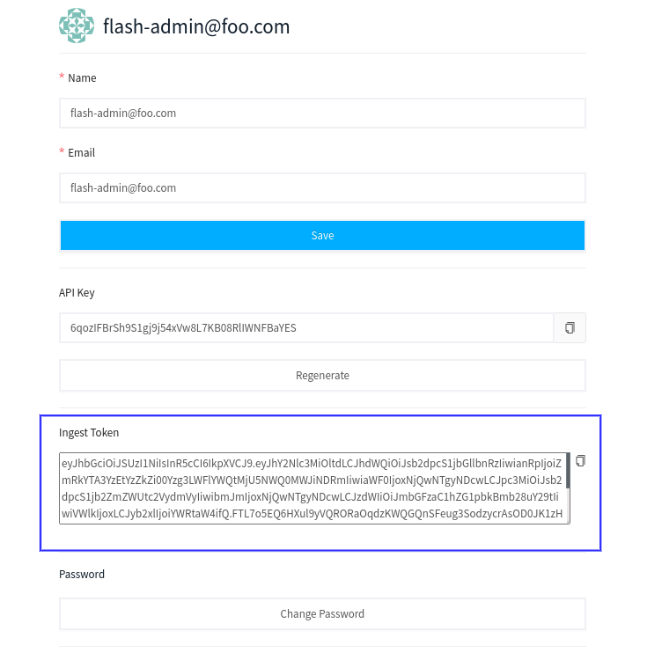

# Generating a secure ingest token

Apica Ascent uses an ingest token to secure the ingestion of log data from your data sources into your Apica Ascent deployment. You can generate a secure ingest token using the Apica Ascent UI.

### Obtaining an ingest token using UI

You can obtain a secure ingest token from the Account tab in the Settings page on the Apica Ascent UI.

To begin, click on the username on the navbar, click "**Settings**", and click on the "Account" tab if you are not brought there by default. Your secure ingest token will be displayed under the **Ingest Token** field. Click the **Copy** icon next to the token to copy it to your clipboard.

You can now use this ingest token while configuring Apica Ascent to ingest data from your data sources.
